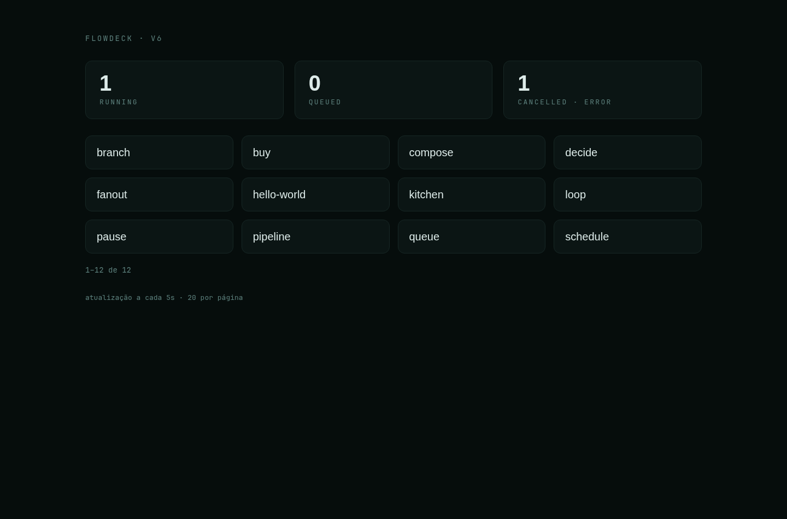
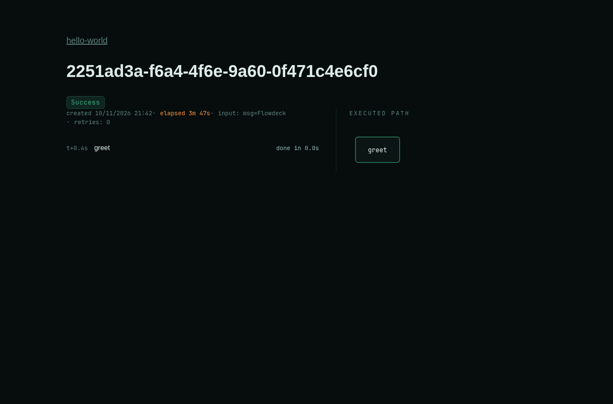
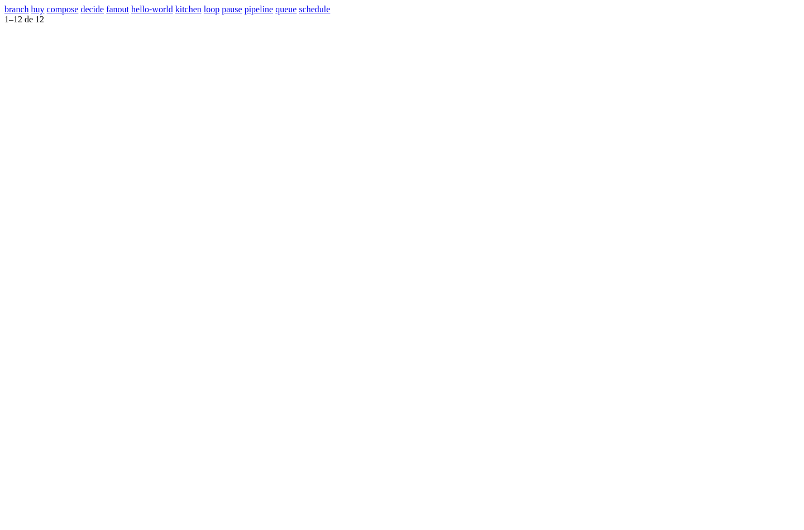
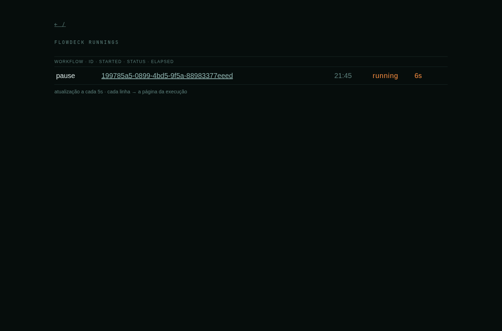
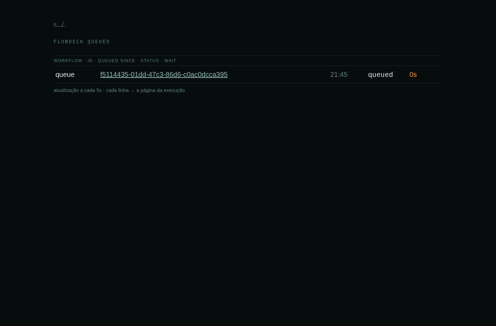

# Flowdeck

[](https://github.com/kleber-yokota/Flowdeck/actions)
[](LICENSE)
[](go.mod)

A frontend to watch a DBOS core: a live control panel for durable
workflows, built entirely in Go (Go + HTMX + DBOS + Postgres 18).

## About the project

**What is DBOS?** A durable-execution engine: the Go SDK
(`dbos-transact-golang`) runs your workflows as named steps on a system
database (Postgres). Steps retry on failure, a run resumes from its last
completed step, and queued or running runs can be cancelled — the
execution survives crashes and restarts.

**Why this project exists.** DBOS's official interface is the **DBOS
Console** — part of Conductor, the control plane: a workflows tab
(running · queued · success · failed), logs and traces. It ships as the
proprietary `dbosdev/console` Docker image (self-hosting for commercial
use needs a license key). For your own app there is no lightweight
official UI — that is exactly what Flowdeck provides: your own panel for
your own workflows, built directly on the SDK.

The project has two purposes:

- **the panel** — observe the DBOS core: every registered workflow has
  a console page, and the dashboard shows the core's live state;
- **the study** — a working example of how to develop with an AI
  assistant: the code, the folder pages, the diagrams and the index are
  written and kept honest by the agent pipeline
  (`diagrams/sequence-agent-flow.html`) under the architecture
  guidelines (`code.md`) — the repo *is* the documentation of assisted
  development.

**What the user sees**

- **The dashboard** — the three live boxes (running · queued · failed),
  refreshed by the 5s poll;
- **The workflow page (the console)** — the command line, the dispatch
  (the spec form, source defaults prefilled), the runlines (the runs,
  newest first, paginated) and the possible-paths graph (SVG);
- **The executions** — the detail page (input · steps · children) with
  cancel and resume;
- **The state pages** — the running, the queued and the failed (the
  queues and the workflows whose latest run failed, with the error
  message).

**The boundary**

- `core/` — the DBOS side: `boot` (the lifecycle), `registry` (what
  exists), `reads` (the durable state — the runs), `board` (the
  live-box reads), `actions` (the only mutations), `status` and `graph`
  (the possible-paths graph), plus the test suites (`testcore`,
  `testworkflows`);
- `web/` — the HTMX side: `catalog` (the dashboard and the workflow
  pages), `executions` (the dispatch/detail), `graph` (the SVGs) and
  `render` (the templates);
- `workflows/` — the example workflows (one subpackage each;
  `zz_generated.go` is generated: `go generate ./workflows`);
- The web never touches DBOS/Postgres: everything goes to the core
  through the `Port` (the single contract), and the forbidden import is
  enforced by a gate.

## Screenshots













## The documentation (and why each piece exists)

The repo is documented for agents to navigate, not just for humans.
Every piece of the process earns its place:

- **The diagram step** (`agent-diagram.md` → the approved diagram): the
  scope is fixed *before* code — the approved diagram is the scope of the
  change; nothing is implemented beyond it. The diagram is what both
  sides read: the LLM grasps the scope from the diagram better than from
  prose, and a human finds it easier to review. A prompt alone is
  ambiguous — not everything is explicit, and the duplicated information
  that comes with it pollutes the execution;
- **The write-task step** (`agent-write-task.md` → the task files): the
  scope is narrowed into task files — one run = one task file. Executing
  from a wide prompt pollutes the agent's context; a small task file
  keeps the execution context tight;
- **`diagrams/` — the maps the agents read** (static HTML + CSS, no
  images, no JS):
  - `package-map.html` — the **boundary map**: who imports whom, at the
    group level — the frontiers, the groups, the fan-in, the suites (the
    green baseline) and the structural gates. Navigation + contact: the
    nodes link to the folder pages; it carries no facts;
  - `sequence-agent-flow.html` — the **agent pipeline**: the WANT →
    diagrams → tasks → green flow, plus the bug loop (read it before the
    agents run);
- **`index.md` — the page index**: read first. One row per page; the
  `covers` column is the keyword set — an agent opens only the pages
  whose covers intersect its touch set. The index holds **no facts**
  (no values, no rules): each fact lives in its folder page, with
  `Evidence` and `Validated`. Without it, an agent re-reads whole files
  on every touch; with it, it opens only what its touch set needs;
- **`scripts/page-index-metric.py` — the quality metric**: the binding
  constraint is the local model — the content must break into pages a
  local model can load efficiently. The metric flags a page whose load
  (README + top-level production lines) crosses the 1000-line flag, and
  a page with too many `covers` topics (flag > 8) — the split keeps every
  page inside a local model's reach;
- **`code.md`** — the architecture guidelines;
- **`AGENT.md`** — the markdown rule for the pages and the index.

## Engineering notes

- **Realtime without websockets** — the badge polls every 2s, the live
  boxes every 5s; cursor pagination (`limit` + `before`); every response
  is an HTMX partial;
- **Deterministic, self-booting tests** — each booted test boots and
  shuts down its own core on a fresh SQLite file; nothing skips;
  `race -count=2 -shuffle` catches registry/state leaks;
- **Code generation** — the workflow registration list is generated
  (`go generate ./workflows` → `zz_generated.go`), and CI checks it is up
  to date;
- **SVG without a JS library** — the possible-paths block DAG and the
  executed path (with the state colors) are rendered server-side in Go.

## Prerequisites

- **Docker + docker compose** to run (the compose brings up
  `postgres:18` on its own);
- **Go 1.27.3** (the `go.mod` version) to build and test.

## Running

### Docker

```bash
cp .env.example .env
docker compose up --build
```

- HTMX webserver: port `FLOWDECK_HTTP_PORT` in `.env` (default `8080`;
  the port inside the container is always `8080`).
- Health endpoint: `GET /healthz` (the container healthcheck uses
  `flowdeck -healthcheck`, since the image is distroless and has no
  `curl`).

### Without Docker

```bash
DBOS_APP_NAME=flowdeck DBOS_SYSTEM_DATABASE_URL=sqlite:./flowdeck.db go run .
```

(the `DBOS_APP_NAME` + `DBOS_SYSTEM_DATABASE_URL` pair is what the core
boots with; a Postgres URL works the same way.)

## Tests

All database tests run on SQLite (Postgres is only the compose
production). The suites are self-booting: each booted test boots and
shuts down its own core (a fresh file per test) — no env, nothing skips,
no `-p 1` (the suite definition: `diagrams/package-map.html#suites`).

```bash
# the `unit` CI job
go test -count=1 ./...

# booted (race, count=2, shuffled — the `race` CI job)
go test -race -count=2 -shuffle=on ./...
```

The suite: 222 test functions across 13 example workflows; the CI runs
three jobs (`unit` · `race` · `vulncheck`) plus the structure gate
(complexity · nesting · cycles · import contract).

## Extending

- **Add a workflow** — create the subpackage in `workflows/` and run
  `go generate ./workflows` (`workflowgen` writes `zz_generated.go`);
- **Add a page** — follow `code.md` (one file per intention; the pages
  and the index move with the code).

## License

MIT — see [LICENSE](LICENSE).
